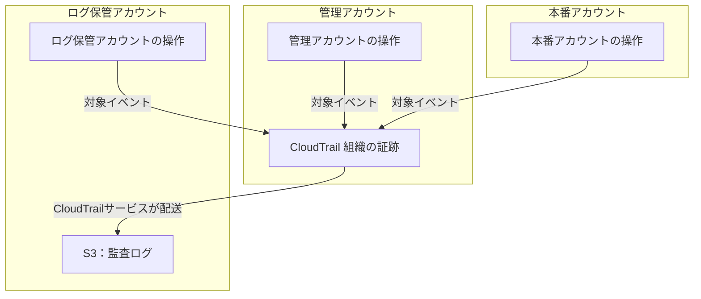
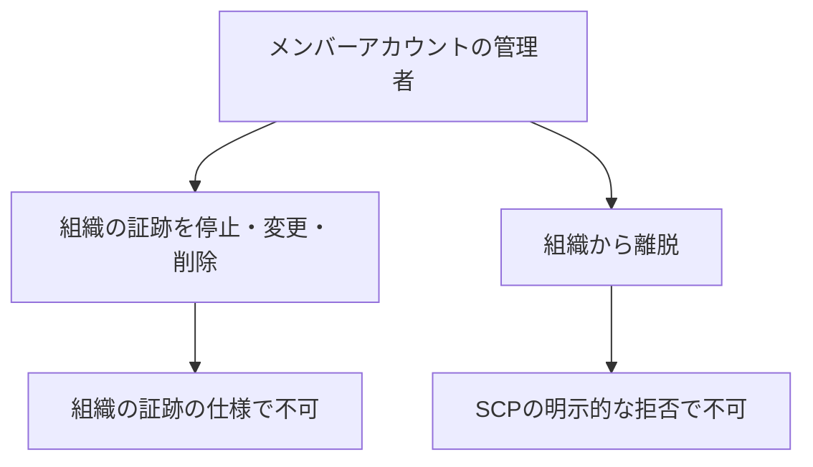
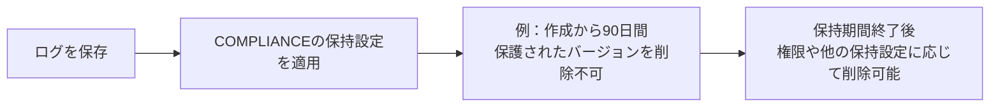
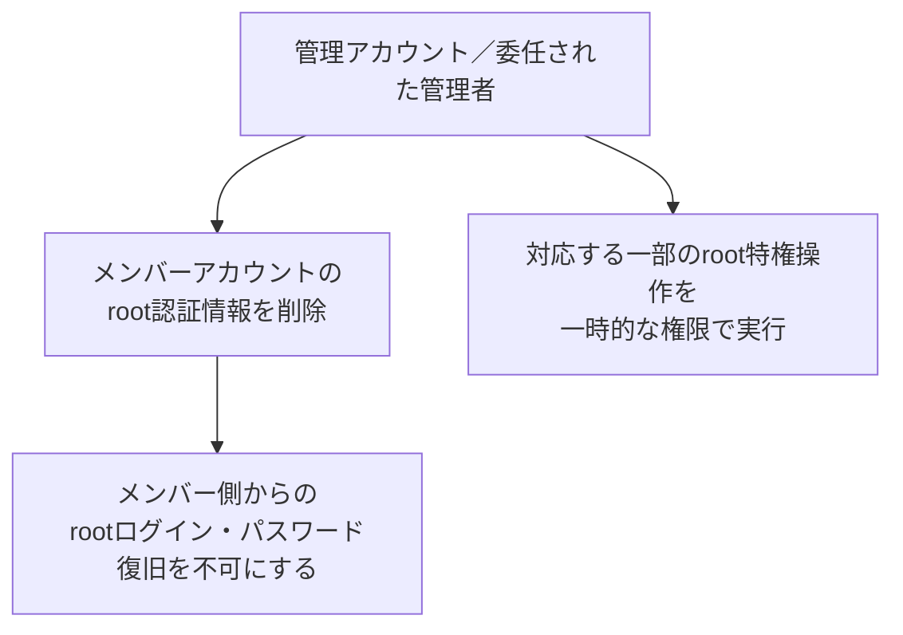
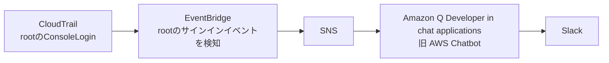

## はじめに

最近、AWSの監査ログまわりを整備していました。

CloudTrailでログを保存するところから始めたのですが、調べてみると「本番アカウントから停止できない証跡」や「rootでも削除できないオブジェクト」など、使ったことのなかった機能がいくつかありました。

今回は、その中で便利だと思った次の機能について書いてみます。

- CloudTrailの組織の証跡と、SCPによる組織離脱の制限
- S3 Object Lockのコンプライアンスモード
- メンバーアカウントのroot認証情報の削除と、rootログイン通知

この記事では、機能の仕様と組み合わせ方を中心に紹介します。構成図は説明用に一般化したもので、具体的な設定手順や実行検証の結果は扱いません。

## 組織の証跡は、メンバーアカウントから止められない

AWS Organizationsを使っている場合、CloudTrailで「組織の証跡」を作成できます。

これを使うと、管理アカウントとメンバーアカウントの対象イベントをまとめて記録できます。新しく組織に追加したアカウントも収集対象になります。

便利なのは、**メンバーアカウントの管理者でも、組織の証跡を停止・変更・削除できない**ところです。証跡の変更・削除は、管理アカウントや委任された管理者側で行います。[組織の証跡の公式ドキュメント](https://docs.aws.amazon.com/awscloudtrail/latest/userguide/creating-trail-organization.html)

本番アカウント内で証跡を管理していると、その管理権限で証跡を停止することもできてしまいます。組織の証跡にすると、設定を管理する場所を本番アカウントの外へ出せます。

保存先もログ保管用のアカウントへ分けると、次のような構成になります。

本番の管理権限とログ保管先を管理する権限を分けることで、本番の権限だけではログ保管先を操作できない構成にできます。アカウントを分けるだけでなく、ロールの引き受けやアクセス権限も合わせて分けておくのがポイントです。

### 組織から抜ける経路も制限できる

ただし、アカウントが組織から外れると、そのアカウントは組織の証跡による収集対象から外れます。

離脱前に保存されたログは残りますが、それ以降の操作は、この証跡では記録されなくなります。[組織から外れた場合の動作](https://docs.aws.amazon.com/awscloudtrail/latest/userguide/creating-trail-organization.html)

そこで、SCPでメンバーアカウントからの組織離脱を禁止できます。`organizations:LeaveOrganization`を明示的に拒否すれば、対象アカウントで管理者権限を持っていても、その操作はできません。[SCPの公式ドキュメント](https://docs.aws.amazon.com/organizations/latest/userguide/orgs_manage_policies_scps.html)

「本番アカウントから証跡を止められない」と「本番アカウントから組織を抜けられない」を組み合わせられるのが便利です。

SCPは管理アカウントには適用されません。管理側からアカウントを除外したり、証跡を変更したりする権限は、引き続き管理する必要があります。

## Object Lockには、rootでも消せないモードがある

次に、保存済みのログを保護します。

S3 Object Lockには、ガバナンスモードとコンプライアンスモードがあります。

| モード | 保持期間中の保護 |
| --- | --- |
| ガバナンス | 特別な権限による回避が可能 |
| コンプライアンス | rootを含め、保護されたバージョンの削除・上書きが不可 |

コンプライアンスモードでは、適用済みの保持期間を短縮することもできません。「管理者なら消せる」という状態を避けられます。[Object Lockの公式ドキュメント](https://docs.aws.amazon.com/AmazonS3/latest/userguide/object-lock.html)

例えば、コンプライアンスモードで90日のデフォルト保持期間を設定すると、その設定が適用される新しいオブジェクトバージョンは、作成から90日間削除できなくなります。

保持期限が過ぎると自動的に削除されるわけではありません。削除するタイミングは、ライフサイクルなどで別に管理します。

組織の証跡で収集設定を保護し、Object Lockで保存済みのログを保護する、という組み合わせになります。

:::message
Object Lockが保護する単位は、オブジェクトのバージョンです。新しいバージョンや削除マーカーの作成まで禁止するわけではありません。

また、バケットにデフォルト保持期間を設定しても、既存オブジェクトに遡って適用されるわけではありません。
:::

保持期間中は自分でも消せなくなるので、期間は必要な調査期間や保管コストに応じて決めます。ここで挙げた90日は説明用の例です。

## メンバーアカウントのrootログインを無効にできる

もうひとつ便利だと思ったのが、rootアクセスの一元管理です。

AWS Organizationsのメンバーアカウントでは、root認証情報を削除できます。パスワードやアクセスキーなどを削除し、メンバーアカウント側からrootでログインしたり、パスワードを復旧したりできない状態にできます。[rootアクセスの一元管理](https://docs.aws.amazon.com/IAM/latest/UserGuide/id_root-enable-root-access.html)

アカウントごとにrootのパスワードやMFAを管理し続ける代わりに、普段はrootでログインできない状態にできます。

一元管理機能を有効にするだけで、既存のroot認証情報が削除されるわけではありません。対象のメンバーアカウントを選んで、削除する操作が必要です。

root権限が必要な一部の作業は、管理側から一時的な権限で実行できます。ログインが必要な作業については、管理側でパスワード復旧を許可する経路もあります。[特権操作の公式手順](https://docs.aws.amazon.com/IAM/latest/UserGuide/id_root-user-privileged-task.html)

## 管理アカウントのrootは通知する

rootアクセスの一元管理の対象はメンバーアカウントで、管理アカウント自身は対象外です。

管理アカウントにはSCPも適用されないので、普段使う権限を絞ることに加えて、rootが使われたときに気づけるようにしておくと良さそうです。

通知経路としては、次のような構成にできます。

EventBridgeで`userIdentity.type`が`Root`の`ConsoleLogin`を拾い、Input Transformerで日時、ログイン結果、接続元IPなどを通知用のJSONへ整形します。SNSとAmazon Q Developer in chat applicationsを経由すると、Lambdaを追加せずにSlackへ通知できます。[カスタム通知の公式ドキュメント](https://docs.aws.amazon.com/chatbot/latest/adminguide/custom-notifs.html)

ここで少し気をつけたいのがリージョンです。現在、rootのConsoleLoginは、認証を処理した`us-east-1`、`us-east-2`、`us-west-2`のいずれかに記録されます。東京リージョンだけにルールを置いても拾えません。[サインインイベントの記録先](https://docs.aws.amazon.com/awscloudtrail/latest/userguide/cloudtrail-event-reference-aws-console-sign-in-events.html)

そのため、これらのリージョンで検知したイベントを通知できるようにします。

一度この通知経路を用意しておくと、今後ほかの操作を通知したくなったときも使えそうです。

## おわりに

CloudTrailまわりを整備していて、次の機能を知りました。

- 組織の証跡はメンバーアカウントから停止・削除できず、組織離脱もSCPで制限できる
- Object Lockのコンプライアンスモードでは、保持期間中のログをrootからの削除からも保護できる
- メンバーアカウントのroot認証情報を削除でき、管理アカウントのroot利用は通知できる

今回はCloudTrailを中心にしましたが、今後はアプリケーションの操作ログも、適切に保護した保管先に残していけると良さそうです。

