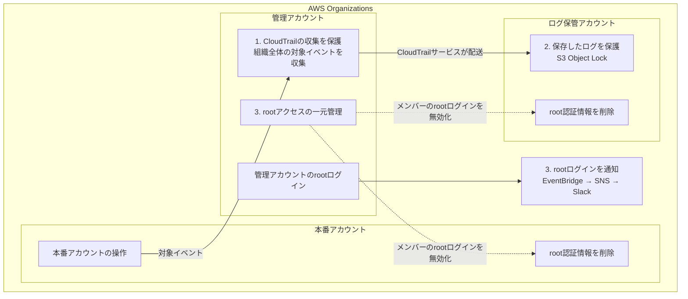
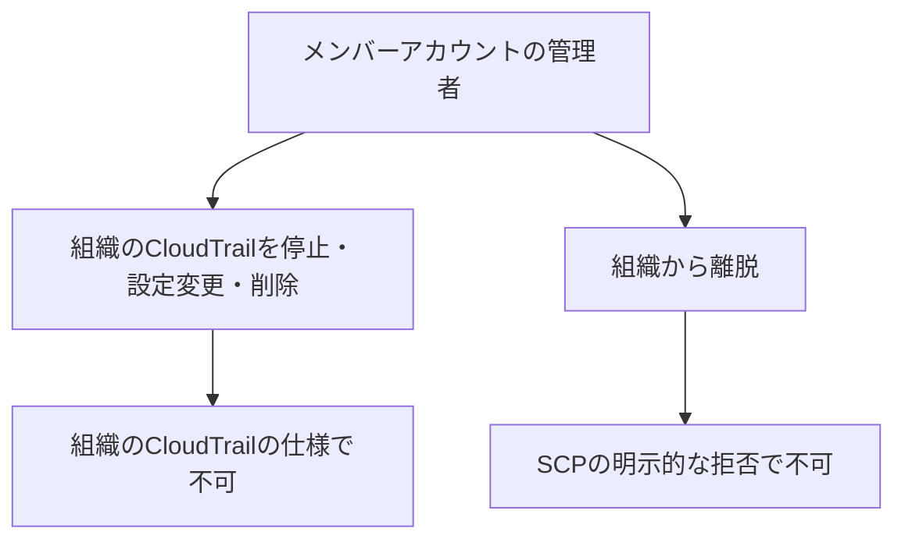
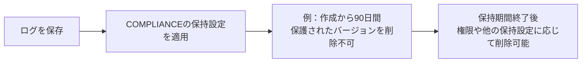
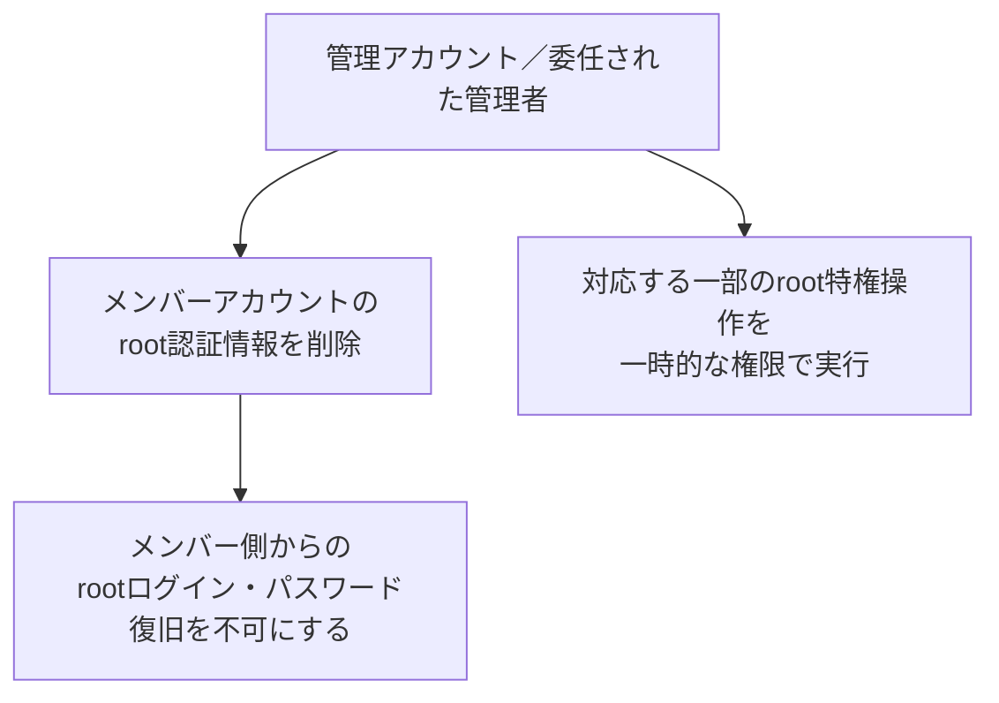
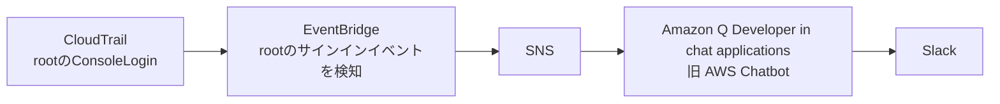

## はじめに

最近、CloudTrailのログ保存まわりをより強固にしたくて、監査ログの収集設定や保存先の権限を見直していました。

複数のAWSアカウントをOrganizationsで組織としてまとめると、CloudTrailの収集設定を各アカウントの管理権限から切り離して管理できます。ほかにも、rootでも削除できないS3 Object Lockのコンプライアンスモードや、メンバーアカウントのrootアクセスを一元管理する機能など、ログやその設定を保護するのに便利な機能があります。

全体像を図にすると、以下のようなイメージです。図の1、2、3が、このあとの見出しに対応しています。構成は説明用に一般化しています。

1ではCloudTrailの収集設定と保存先を本番の管理権限から切り離し、SCP（Service Control Policy：サービスコントロールポリシー）で組織離脱も制限します。2では保存済みのログの削除を防ぎ、3ではrootログインの無効化と、無効化できない管理アカウントのrootログイン通知を扱います。

今回は、監査ログを保護するためにCloudTrailとその周辺の機能を整理したときの備忘録です。

## 1. CloudTrailの収集を保護する

AWS Organizationsを使っている場合、CloudTrailで組織全体のログをまとめて収集する設定を作成できます。正式には「組織の証跡（organization trail）」という機能ですが、この記事では「組織のCloudTrail」と呼びます。

これを使うと、管理アカウントとメンバーアカウントの対象イベントをまとめて記録できます。新しく組織に追加したアカウントも収集対象になります。

便利なのは、**メンバーアカウントの管理者でも、組織のCloudTrailによるログ収集を停止したり、その設定を変更・削除したりできない**ところです。設定の変更・削除は、管理アカウントや委任された管理者側で行います。

https://docs.aws.amazon.com/awscloudtrail/latest/userguide/creating-trail-organization.html

本番アカウント内でCloudTrailの収集設定を管理していると、その管理権限でログ収集も停止できてしまいます。組織でCloudTrailを管理すると、設定を管理する場所を本番アカウントの外へ出せます。
IAMで権限調整を頑張るのではなく、そもそも仕組み上出来ないようにしてしまうというのが良いですね。

### 保存先を別アカウントへ分ける

ログの保存先も、本番とは別のアカウントへ分けます。はじめの図では、CloudTrailからログ保管アカウントのS3へ配送している部分です。

本番の管理権限とログ保管先を管理する権限を分けることで、本番の権限だけではログ保管先を操作できない構成にできます。アカウントを分けるだけでなく、ロールを引き受ける権限も合わせて分けておくと良さそうです。

### SCPで組織離脱を禁止する

アカウントが組織から外れると、そのアカウントは組織のCloudTrailによる収集対象から外れます。
離脱前に保存されたログは残りますが、それ以降の操作は、組織のCloudTrailでは記録されなくなります。

https://docs.aws.amazon.com/awscloudtrail/latest/userguide/creating-trail-organization.html

そこでSCP、Service Control Policyです。
SCPは、AWS Organizationsのメンバーアカウントで実行できる操作の上限を制限するポリシーです。これを使って、メンバーアカウントからの組織離脱を禁止できます。`organizations:LeaveOrganization`を明示的に拒否すれば、対象アカウントで管理者権限を持っていても、その操作はできません。

https://docs.aws.amazon.com/organizations/latest/userguide/orgs_manage_policies_scps.html

「本番アカウントからCloudTrailのログ収集を止められない」と「本番アカウントから組織を抜けられない」を組み合わせられるのが便利です。

SCPは管理アカウントには適用されません。管理側からアカウントを除外したり、CloudTrailの設定を変更したりする権限は、引き続き管理する必要があります。

## 2. Object Lockでログの削除を防ぐ

次は、はじめの図の2にあたる、保存済みのログを保護する部分です。
S3 Object Lockには、ガバナンスモードとコンプライアンスモードがあります。

| モード | 保持期間中の保護 |
| --- | --- |
| ガバナンス | 特別な権限による回避が可能 |
| コンプライアンス | rootを含め、保護されたバージョンの削除・上書きが不可 |

コンプライアンスモードでは、適用済みの保持期間も短縮できません。「管理者なら消せる」という状態を避けられます。
**保持期間中は誰も消せない** となると削除権限のことは考えなくても良くなるのでとても好きです。

https://docs.aws.amazon.com/AmazonS3/latest/userguide/object-lock.html

例えば、コンプライアンスモードで90日のデフォルト保持期間を設定すると、その設定が適用される新しいオブジェクトバージョンは、作成から90日間削除できなくなります。

保持期限が過ぎると自動的に削除されるわけではありません。削除するタイミングは、ライフサイクルなどで別に管理します。
組織のCloudTrailで収集設定を保護し、Object Lockで保存済みのログを保護する、という組み合わせになります。
保持期間中は自分でも消せなくなるので、期間は必要な調査期間や保管コストに応じて決めます。

## 3. rootアクセスを管理する

最後は、はじめの図の3にあたるrootアクセスの管理です。メンバーアカウントではrootログインを無効にし、対象外の管理アカウントではログインを通知する、という形にします。

### メンバーアカウントのrootログインを無効にする

AWS Organizationsのメンバーアカウントでは、root認証情報を削除できます。パスワードやアクセスキーなどを削除し、メンバーアカウント側からrootでログインしたり、パスワードを復旧したりできない状態にできます。

https://docs.aws.amazon.com/IAM/latest/UserGuide/id_root-enable-root-access.html

アカウントごとにrootのパスワードやMFAを管理し続ける代わりに、普段はrootでログインできない状態にできます。

一元管理機能を有効にするだけで、既存のroot認証情報が削除されるわけではありません。対象のメンバーアカウントを選んで、削除する操作が必要です。

root権限が必要な一部の作業は、管理側から一時的な権限で実行できます。ログインが必要な作業については、管理側でパスワード復旧を許可する方法もあります。

https://docs.aws.amazon.com/IAM/latest/UserGuide/id_root-user-privileged-task.html

### 管理アカウントのrootログインを通知する

rootアクセスの一元管理の対象はメンバーアカウントで、管理アカウント自身は対象外です。
管理アカウントはSCPの適用対象外です。普段使う権限を絞り、rootの利用を通知で把握できると良いのではないかと考えています。
通知の仕組みとしては、次のような構成にできます。

EventBridgeで`userIdentity.type`が`Root`の`ConsoleLogin`を拾い、Input Transformerで日時、ログイン結果、接続元IPなどを通知用のJSONへ整形します。SNSとAmazon Q Developer in chat applicationsを経由すると、Lambdaを追加せずにSlackへ通知できます。

https://docs.aws.amazon.com/chatbot/latest/adminguide/custom-notifs.html

ここで少し気をつけたいのがリージョンです。現在、rootのConsoleLoginは、認証を処理した`us-east-1`、`us-east-2`、`us-west-2`のいずれかに記録されます。東京リージョンだけにルールを置いても拾えません。

https://docs.aws.amazon.com/awscloudtrail/latest/userguide/cloudtrail-event-reference-aws-console-sign-in-events.html

そのため、これらのリージョンで検知したイベントを通知できるようにします。

一度この通知の仕組みを用意しておくと、今後ほかの操作を通知したくなったときも使えそうです。

## まとめ

CloudTrailの収集設定を本番の管理権限から切り離し、保存したログも保護する、という形で整理しました。

- 組織のCloudTrailはメンバーアカウントからログ収集の停止や設定の削除ができず、組織離脱もSCPで制限できる
- Object Lockのコンプライアンスモードでは、保持期間中のログをrootでも削除できない状態にできる
- メンバーアカウントのroot認証情報を削除でき、管理アカウントのroot利用は通知できる

やってみると欲しい機能が結構揃っているなと感じました。
AWSとても便利。
