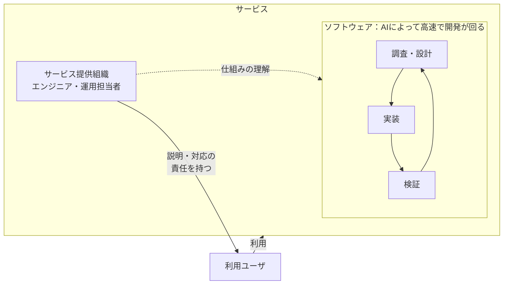

## はじめに

最近は、AI Agentを使ってコードを書くことが日常になりました。その一方で、自分で直接コードを書く頻度は本当に減ったと感じています。何年もかけて少しずつ変わったというより、ここ2年も経たないうちの変化です。

今や新しいモデルが出るたびに、Artificial Analysisのグラフを眺めています。少し前まで十分良いと思っていた性能を上回りつつ、速度も出て、コストとのバランスも良いのはどのあたりか。モデルと推論にかける労力（Reasoning Effort）の組み合わせを見て、「このへんが良さそうかな」と思ったものを試す日々になっています。

そんな中で、ふと「5年後くらいには、エンジニアとしての仕事はどうなっているんだろうか」と考える機会がありました。せっかくなので、今の考えを整理しておこうと思います。

今のところ、5年後のエンジニアは、今よりコードを書かない一方で、今より多くのソフトウェアに責任を持つ職業になっているのではないかと思っています。AIへの委任がPRから機能やプロダクトの単位へ広がれば、PR単位で仕事を捉えていた人も、サービス全体を見るようになるのかもしれません。その責任を果たせる開発プロセスやAIの実行環境を設計する仕事が、今より大きくなるのではないかと考えています。

たとえば、サービスで想定外の何かが起きたときに、ユーザへ説明し、対応に責任を持つことも含まれます。

そうした説明や対応に責任を持つには、提供する側がサービスの仕組みを理解している必要があります。AIに開発を任せるようになっても、ソフトウェアをブラックボックスとして扱うわけにはいかない。そこにエンジニアとしての責務が残るのだと思っています。

## 前提：AIによる開発の変化

自分の中で変化を強く意識し始めたのは、2025年2月26日に公開された、mizchi氏の「CLINEに全部賭けろ」あたりです。業界全体の始まりという話ではなく、AIに作業を任せて実装と確認を繰り返してもらう開発が、身近になってきた時期という感覚です。

https://zenn.dev/mizchi/articles/all-in-on-cline

そこから2026年11月の今まで、まだ2年も経っていません。今や自分の感覚では、Claude Codeに実装を任せてPRを作ってもらうことも、ほぼ当たり前になっています。

レバテックが2026年7月15日に公表した調査では、AIを毎日使うITエンジニアが43.4％、週に数回使う人が28.3％で、合わせて71.7％でした。コーディング・実装に活用している割合は40.9％です。調査期間は2026年5月26日〜28日、対象は20〜59歳のITエンジニア572名です。

https://leverages.jp/news/2026/0715/5932/

これはAI全般の業務利用についての数字で、Claude CodeでPRを作る人の割合ではありません。自分の実感と業界全体での普及は分けて見たいですが、AIを日常的に使うこと自体は広がっているようです。

## 論点：開発をAIに任せても、説明責任は残る

自分が考えている構造を図にすると、こんな感じです。

### サービスを利用するユーザ

サービスの内側では、AIによってソフトウェアの開発が高速で回っています。利用ユーザが触れるのは、その外側のサービスです。

たとえば、予約サービスで予約が消えてしまったとします。ソフトウェアの中ではデータの不整合でも、利用ユーザにとっては、取れていたはずの予約がなくなってしまう出来事です。

### サービス提供側の説明責任

何が起きたのか、誰に影響したのか、どう対応するのかを説明するのは、サービスを提供する側の人間や組織です。「AIが作ったので分かりません」では、利用ユーザへの説明責任を果たせません。

ここでいう説明は、障害が起きた後の報告だけではありません。普段から、なぜこの挙動にしたのか、どのような制約やリスクがあるのかを説明するためにも、仕組みの理解が必要です。

### 説明や対応に必要な仕組みの理解

どこで予約データが変わるのか。どの処理に依存しているのか。何を調べれば影響範囲が分かり、どうすれば復旧できるのか。仕組みを理解していなければ、説明や対応の根拠も持てません。

ソフトウェアの挙動と、利用ユーザに起きていることをつなげて理解する。そこにエンジニアの責務があると思っています。実装をAIに任せても、説明責任を果たすために必要な理解まで手放すわけにはいきません。

問題が起きたとき、対応を急いでAIの説明や修正を確かめずに採用すると、かえって問題を広げる可能性もあります。ログや実際の挙動をたどり、何が起きていて、その対応が妥当かを地道に確かめる。結果として、そのほうが早いのかもしれません。急がば回れ、ということなのだと思います。

## 考察：AIに開発を任せる範囲が広がる中で、サービス全体への責任をどう果たすか

### AIに開発を任せる単位の変化：PRから機能・プロダクトへ

今はAIにPRを作ってもらい、その差分を確認する形でも、今後は「この機能を提供したい」「このプロダクトを改善したい」という単位で任せることが増えるのではないかと思います。

PR単位で仕事を捉えていた場合、人間が責任を持つ範囲も、個々の差分から機能やプロダクト全体へ広がるのかもしれません。何を満たせばユーザに届けてよいのかを決め、提供後の挙動や影響を把握する。そのために理解する対象も、差分だけでなく、サービスを支えるソフトウェア同士の関係まで広がりそうです。

### すでにフルサイクルで関わっていた場合

一方で、AI Agentによる開発が広がる以前から、サービス全体に責任を持っていた場合もあります。Netflixが2018年に公開したフルサイクル開発者の記事では、開発チームが設計から運用、サポートまで責任を持つモデルが紹介されています。CARTA TECH BLOGに日本語訳が掲載されています。

https://techblog.cartaholdings.co.jp/entry/2019/02/04/171325

原文はこちらです。

https://netflixtechblog.com/full-cycle-developers-at-netflix-a08c31f83249

ツールや自動化への投資によって、チームが開発から運用まで責任を持てるようにする考え方だという理解です。

以前からこうしたフルサイクルエンジニアリングをしていたなら、責任を持つ範囲がPRからサービス全体へ広がる、という変化はありません。AIに任せる単位が大きくなっても、作ったものの利用や運用まで責任を持つという本質は変わらないのだと思います。

### 責任を果たせる開発プロセスとハーネス

どちらの場合も、AIに任せる範囲や変更の量が増える中で、サービス全体を理解できる状態を保つ必要がありそうです。自分で実装しながら把握していたことも、任せた先では別の方法で確かめる必要があります。

そこで重要になるのが、理解と判断に必要な情報を得られる開発プロセスやハーネスの設計なのだと思います。ここではハーネスを、AIに渡す仕様や制約、使えるツールや権限、検証や記録の仕組みを含む実行環境として考えています。

どこまで自動で進めてよいか、どの条件で人間に判断を戻すか、何を根拠に成果物を受け入れるかを決めておく。変更の意図や検証結果を追え、必要なときに調べたり止めたりできるようにする。任せる範囲と、責任を果たせる範囲を揃えていく必要がありそうです。

すべての実装を頭に入れるのは難しくても、重要な振る舞いや依存関係を把握し、分からないところは調べられる状態を保ちたいです。テストやログ、必要なコードをたどって、AIの説明と実際の挙動が合っているかを確かめることも含まれます。

以前のレビュー記事でも、確認の自動化を進めた先に、仕様や背景の理解をチームで揃える時間が残るのではないかと考えていました。

https://zenn.dev/ara_ta3/articles/thinking-about-review-in-ai-agent-development

そうした理解の共有も、チームとしてサービスの仕組みや変更の理由を説明できる状態を保つことにつながると思っています。

Addy Osmani氏の「Own the Outer Loop」も、AIが調査・実装・検証を繰り返す一方で、人間がその境界で判断し、理由を説明できることを重視する考え方だという理解です。

https://addyo.substack.com/p/own-the-outer-loop

### 仕組みを理解する力をどう身につけるか

ただ、理解を保つという話は、すでに開発経験があることを前提にしている気もします。これから経験を積むジュニアは、その理解をどう身につければよいのでしょうか。

自分で実装して、動かなくて調べて、直す。その過程は、仕組みを理解する機会でもありました。Addy氏の「Don't Outsource the Learning」でも、タスクを完了することと、学ぶことは別の目標として扱われています。AIに実装を任せるなら、学習の機会も意識して作る必要があるのかもしれません。

https://addyosmani.com/blog/dont-outsource-learning/

その点で、Addy氏が別の記事で書いているジュニア向けの助言も参考になりそうです。AIの出力を学習材料として読み解いたり、経験者と設計の理由を話したりすることが勧められています。

https://addyo.substack.com/p/beyond-the-70-maximizing-the-human

たとえば、小さな変更について、どう動くかを予想し、コードやテストで確かめ、その理由を説明してみる。AIの出力を題材にしても、そうした経験を積めるのではないかと思います。チームとして、その説明を一緒に確かめる時間を持てると良さそうです。

## おわりに

5年後は、AIに任せる単位がPRから機能やプロダクトへ広がっているのではないかと思います。PR単位で仕事を捉えていたなら、責任を持つ範囲も広がりそうです。すでにフルサイクルで関わっていたなら、その責務は以前から担ってきたものです。

AIに実装を任せても、サービスを使うのは人間です。利用ユーザに説明し、対応するために、提供側が仕組みを理解する必要は残ると思っています。任せる範囲が広がる中で、その理解を保ち、責任を果たせる開発プロセスやハーネスを設計することが、今より大きな仕事になりそうです。

とはいえ、AIも開発の進め方も変わり続けています。今の考えを固定せず、その時々で何をAIに任せ、人間が何を理解しておく必要があるのかを考え続けることが大事なのだと思います。
