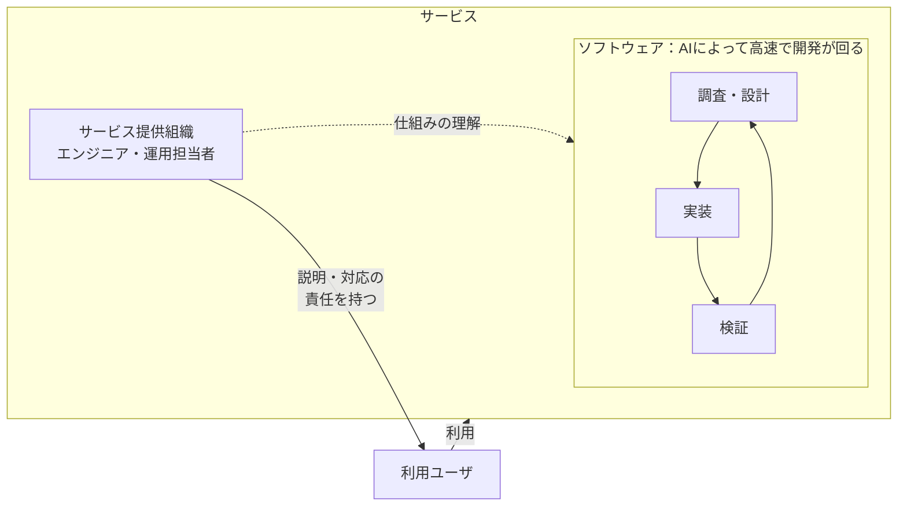

## はじめに

5年後、エンジニアがコードを書く時間は今より減っているかもしれません。それでも、利用ユーザへの説明責任を果たすために、サービスの仕組みを理解する責務は残ると思っています。

AIに開発を任せるようになっても、ソフトウェアをブラックボックスとして扱うわけにはいかない。最近の流れを備忘録として残しつつ、なぜそう考えているのかを整理してみます。5年という数字に明確な根拠はなく、少し先を考えるための時間軸として置いています。

## 前提：AIによる開発の変化

自分の中で変化を強く意識し始めたのは、2025年2月26日に公開された、mizchi氏の「CLINEに全部賭けろ」あたりです。業界全体の始まりという話ではなく、AIに作業を任せて実装と確認を繰り返してもらう開発が、身近になってきた時期という感覚です。

https://zenn.dev/mizchi/articles/all-in-on-cline

そこから2026年11月の今まで、まだ2年も経っていません。今や自分の感覚では、Claude Codeに実装を任せてPRを作ってもらうことも、ほぼ当たり前になっています。

レバテックが2026年7月15日に公表した調査では、AIを毎日使うITエンジニアが43.4％、週に数回使う人が28.3％で、合わせて71.7％でした。コーディング・実装に活用している割合は40.9％です。調査期間は2026年5月26日〜28日、対象は20〜59歳のITエンジニア572名です。

https://leverages.jp/news/2026/0715/5932/

これはAI全般の業務利用についての数字で、Claude CodeでPRを作る人の割合ではありません。自分の実感と業界全体での普及は分けて見たいですが、AIを日常的に使うこと自体は広がっているようです。

## 論点：開発を任せても、説明責任は残る

自分が考えている構造を図にすると、こんな感じです。

### サービスを利用するユーザ

サービスの内側では、AIによってソフトウェアの開発が高速で回っています。利用ユーザが触れるのは、その外側のサービスです。

たとえば、予約サービスで予約が消えてしまったとします。ソフトウェアの中ではデータの不整合でも、利用ユーザにとっては、取れていたはずの予約がなくなってしまう出来事です。

### サービス提供側の説明責任

何が起きたのか、誰に影響したのか、どう対応するのかを説明するのは、サービスを提供する側の人間や組織です。「AIが作ったので分かりません」では、利用ユーザへの説明責任を果たせません。

ここでいう説明は、障害が起きた後の報告だけではありません。普段から、なぜこの挙動にしたのか、どのような制約やリスクがあるのかを説明するためにも、仕組みの理解が必要です。

### 説明や対応に必要な仕組みの理解

どこで予約データが変わるのか。どの処理に依存しているのか。何を調べれば影響範囲が分かり、どうすれば復旧できるのか。仕組みを理解していなければ、説明や対応の根拠も持てません。

ソフトウェアの挙動と、利用ユーザに起きていることをつなげて理解する。そこにエンジニアの責務があると思っています。実装をAIに任せても、説明責任を果たすために必要な理解まで手放すわけにはいきません。

## 考察：フルサイクル開発から何が変わるのか

### 以前から担っていた責務

これはAIによって初めて生まれる責務ではありません。Netflixが2018年に公開したフルサイクル開発者の記事でも、開発チームが設計から運用、サポートまで責任を持つモデルが紹介されています。CARTA TECH BLOGに日本語訳が掲載されています。

https://techblog.cartaholdings.co.jp/entry/2019/02/04/171325

原文はこちらです。

https://netflixtechblog.com/full-cycle-developers-at-netflix-a08c31f83249

ツールや自動化への投資によって、チームが開発から運用まで責任を持てるようにする考え方だという理解です。

以前からこうしたフルサイクルエンジニアリングをしていたなら、AIが入っても、本質的にやることは変わらないのだと思います。作ったものがどう使われ、何が起きているかを把握し、問題があれば調べて対応する。その責務は以前からあったものです。

### AIに任せながら理解を保つ方法

変わるのは、その責任を果たすための手段や、扱う変更の量と速度なのかもしれません。自分で実装しながら理解していた部分をAIに任せるなら、別の方法で理解を保つ必要がありそうです。

もちろん、ライブラリやインフラまで含めて、すべての実装を頭に入れておくのは難しいです。説明責任を果たすために必要なのは、サービスの重要な振る舞いや依存関係を把握し、分からないところは調べて判断できる状態だと思っています。

そのためには、必要なコードを読むこともあれば、テストで前提を確かめたり、ログや監視から実際の動きを追ったりすることもあります。AIの説明も役に立ちますが、実際の挙動と合っているかは確かめたいです。

以前の記事では、レビューが担う仕事を分解し、テストや仕組み、AIによる事前確認へ移していきたいと考えていました。

https://zenn.dev/ara_ta3/articles/thinking-about-review-in-ai-agent-development

確認を任せることと、人間が理解を保つことは両立させたいです。PRを承認していても、説明に必要な理解が得られたとは限りません。

Addy Osmani氏の「Own the Outer Loop」も、AIが調査・実装・検証を繰り返す一方で、人間がその境界で判断し、理由を説明できることを重視する考え方だという理解です。

https://addyo.substack.com/p/own-the-outer-loop

変更の意図や検証結果を追え、必要なときに調べたり止めたりできる仕組みを整える。それも、説明責任を支えるエンジニアリングの仕事なのだと思います。

## おわりに

AIに実装を任せても、サービスを使うのは人間です。利用ユーザに説明し、対応するために、提供側が仕組みを理解する必要は残ります。

その責務はフルサイクル開発でも担ってきたものです。5年後に使うツールが変わっていても、説明し、判断し、対応できる状態は保ちたいです。
